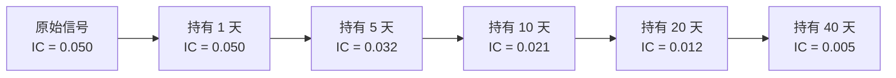

评价一个因子时，最容易犯的错误是只看 IC（信息系数）和 ICIR，不看它需要多少换手才能兑现。

一个 IC = 0.05 但每天换手 100% 的因子，几乎注定亏钱；一个 IC = 0.03 但一个月才换一次的因子，可能是台印钞机。

## 因子收益的完整分解

因子能拿到的收益可以粗略写成：

$$
R_{net} = IC \cdot \sigma_{cs} \cdot \sqrt{B} - c \cdot TO
$$

其中：

- $IC$：因子与下期收益的截面相关系数
- $\sigma_{cs}$：个券收益的截面标准差
- $B$：策略的广度（独立下注次数）
- $c$：单边交易成本
- $TO$：期间换手率

关键在最后一项：**成本是线性的，而信息收益只随 $\sqrt{B}$ 增长。**

## IC 衰减曲线

因子的预测能力随预测期拉长而衰减。把 IC 对不同的持有期 $h$ 画出来，就得到衰减曲线。

这张图决定了因子的**最佳持有期**——也就是"信息还在，但成本已经不值得再等"的那个拐点。

## 一个具体的计算

假设：

- $IC = 0.05$，$\sigma_{cs} = 2\%$（日频截面波动）
- 单边成本 $c = 0.15\%$（含冲击成本）

**方案 A：日频调仓（$TO = 1.0$）**

$$
R_{net} = 0.05 \times 0.02 - 0.0015 \times 1.0 = 0.001 - 0.0015 = -0.0005
$$

每天亏 5 个基点。**因子 IC 是正的，但策略是亏的。**

**方案 B：5 日调仓（$TO = 0.2$，IC 衰减到 0.032）**

$$
R_{net} = 0.032 \times 0.02 - 0.0015 \times 0.2 = 0.00064 - 0.0003 = 0.00034
$$

每个持有期赚 3.4 个基点，折合年化约 8.5%。

**同一个因子，只因为调仓频率不同，从亏钱变成了赚钱。**

## 控制换手的四个手段

### 1. 缓冲带（Buffer Zone）

建仓和调仓用**不同**的阈值，中间留一条缓冲带。

比如：排名前 10% 才买入，但只有在跌出前 20% 时才卖出。这样小幅排名波动不会产生交易。实测通常能降低 30%–50% 的换手，而 IC 几乎不受影响。

### 2. 信号平滑

对因子做指数加权移动平均后再排序：

$$
\tilde{f}_t = \alpha f_t + (1 - \alpha) \tilde{f}_{t-1}
$$

$\alpha$ 越小，换手越低，但信号滞后越严重。需要和衰减曲线一起权衡。

### 3. 交易成本感知的优化

在组合优化里直接把成本写进目标函数：

$$
\max_w \quad w^\top \mu - \lambda w^\top \Sigma w - c \|w - w_{prev}\|_1
$$

这个 $L_1$ 惩罚项会自动抑制没有足够信息支撑的调仓。

### 4. 执行层面的批量化

把同向的调仓指令合并到同一个时间窗口执行，用被动单（限价单）而不是主动单。这一条不改变策略，纯粹是降低成本——但往往比上面三条加起来还有效。

## 自检清单

评估任何新因子时，我都会问这四个问题：

| 问题 | 为什么重要 |
| --- | --- |
| IC 衰减到一半需要几天？ | 决定持有期上限 |
| 对应的换手率是多少？ | 决定成本下限 |
| 扣掉成本后还是正的吗？ | 一票否决项 |
| 换手集中在哪些标的？ | 高换手 + 低流动性 = 冲击成本爆炸 |

## 结论

**因子研究的目标不是找到 IC 最高的因子，而是找到"信息衰减最慢、同时换手最低"的因子。**

IC 高的因子人人抢，很快被套利掉；而"衰减慢 + 换手低"的组合，往往能活得更久——因为它不被交易成本惩罚。
