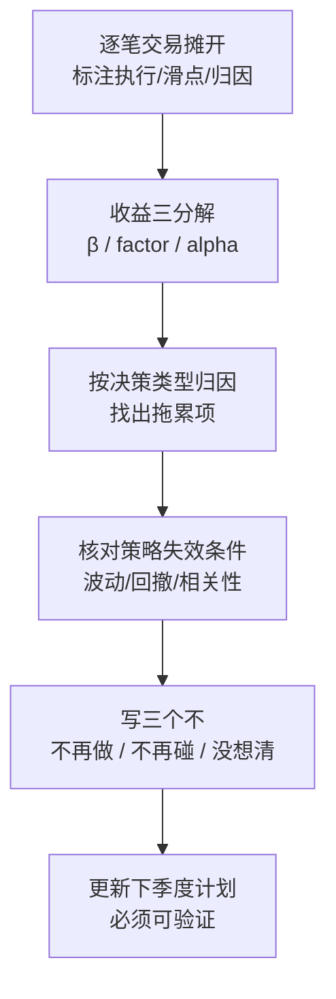

季度复盘最大的陷阱是**叙事偏差**：你会不自觉地围绕"这季度赚了/亏了"编一个自洽的故事，然后从这个故事里提炼"经验"。

如果季度是赚的，你提炼的经验大概率是错的——它可能只是运气。如果季度是亏的，你提炼的"教训"也可能过度反应。

所以复盘必须**自下而上**，先看数据，再看结论。

## 第一步：把逐笔交易摊在桌面上

不要看收益率，先看每一笔。对每笔交易标注四件事：

1. **是否按信号执行**（是 / 否）
2. **执行时的滑点**
3. **这笔的盈亏**
4. **盈亏的来源**：方向判断正确 / 个股特异波动 / 市场整体 β

标完之后，第一个关键统计量出来了：

> **按信号执行的交易，平均盈亏 vs. 未按信号执行的交易，平均盈亏。**

如果后者反而更好，需要非常警惕——这可能是样本太小的噪音。但如果连续两个季度都是这样，那要重新审视的就不是执行力，而是**信号本身**了。

## 第二步：把收益拆成三块

$$
R_{total} = R_{\beta} + R_{factor} + R_{alpha}
$$

- $R_{\beta}$：市场整体带来的，这部分不算本事
- $R_{factor}$：暴露在已知风格因子（规模、价值、动量等）上的收益，也不算本事
- $R_{alpha}$：扣掉上面两块之后剩下的，这才是策略真正的贡献

**绝大多数"跑赢大盘"的季度，超额全部来自 $R_{beta}$ 或某个因子的暴露。** 把这三块拆开之后，你会对策略的真实能力冷静很多。

## 第三步：按"决策"而不是按"标的"归因

传统归因按持仓标的拆，但这对改进策略帮助有限——你不会因为"标的 A 亏钱了"就获得洞察。

更好的做法是按**决策类型**拆：

| 决策类型 | 本季度次数 | 平均贡献 | 结论 |
| --- | --- | --- | --- |
| 按信号建仓 | 42 | +0.35% | 有效 |
| 按信号止损 | 18 | +0.12% | 有效，但触发偏晚 |
| 跳过信号 | 7 | −0.55% | 显著拖累，需查原因 |
| 手动加仓 | 3 | −0.90% | 负面，考虑禁止 |

这张表会直接指向行动，而不是停留在"这季度还行"。

## 第四步：检查策略的"失效条件"是否出现

每个策略在建立时都应该写下过它的失效条件。季度复盘时逐条核对：

- 原本预期的年化波动 12%，实际 18% → **超限**
- 原本预期最大回撤 15%，实际 17% → 接近上限
- 原本预期与基准相关性 0.3，实际 0.72 → **策略正在退化成 β**

**最后一条最容易被忽略，也最危险**：一个慢慢变成"指数放大器"的策略，看起来还在赚钱，但已经不再提供它承诺的东西了。

## 第五步：写"三个不"

复盘结尾，我强制自己写三段，每段必须具体：

1. **不再做的事**：本季度发现的、明确无效的动作。
   *例：不再在开盘前 15 分钟下单，滑点系统性偏高。*
2. **不再碰的标的/参数**：明确划出禁区。
   *例：不再对日均成交额低于 5,000 万的标的建模。*
3. **还没想清楚的问题**：诚实地列出来，不要硬给结论。
   *例：止损触发偏晚，是阈值问题还是我在手动拖延？尚无定论。*

第三段是最难写的，也是最有价值的。**一份全是结论的复盘，通常是在自欺。**

## 流程总览

## 一句话总结

**复盘的产出不是一份总结，而是下个季度要执行的具体约束。**

如果一场复盘结束时，你没有得到任何一条能写进规则里的"不再做某件事"，那这场复盘大概率只是自我安慰。
